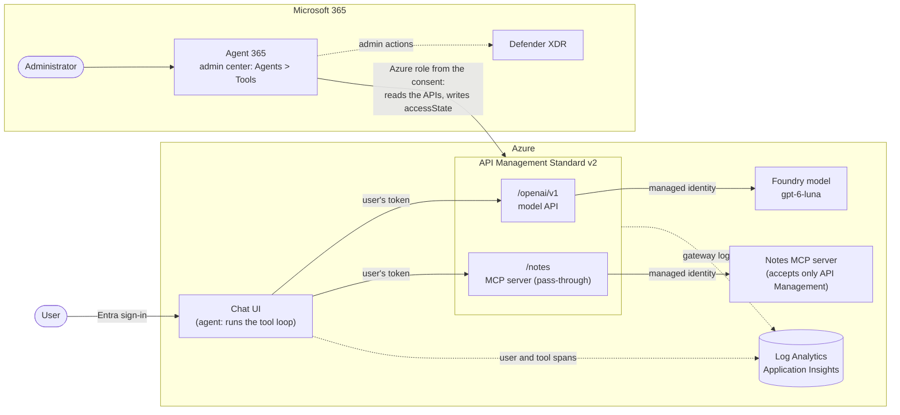
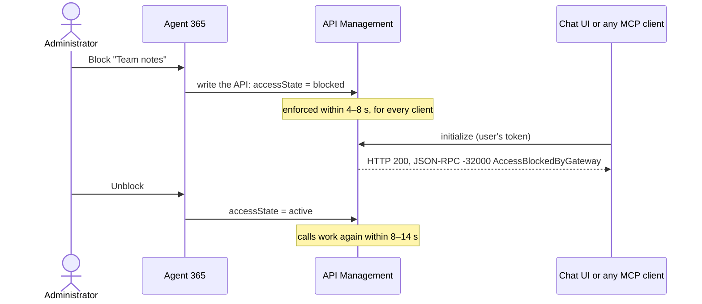

<div align="center">

# Governing API Management MCP servers with Agent 365

**What Agent 365 governs on an API Management gateway, measured: which calls a block stops, how fast, and at what granularity.**

[](LICENSE)
[](docs/FINDINGS.md)
[](infra)
[](infra)

[**Key findings**](#key-findings) · [**The setup**](#the-setup) · [**Documents**](#documents) · [**Environment**](#environment)

</div>

**Question:** When an Azure API Management gateway is connected to Agent 365, what is actually governed: which calls a block stops and how fast, at what granularity, how new or changed MCP servers are noticed, with which identity and permissions, which controls we have in Agent 365, and with which audit records?

**Time box:** 2 days · **Status:** done for Standard v2 — see [the findings](docs/FINDINGS.md) · **Variant:** the same question with a LiteLLM gateway, in [spike-agent365-litellm-tools-gateway](https://github.com/ikhemissi/spike-agent365-litellm-tools-gateway)

> As of November 2026, connecting gateways to Agent 365 in the Microsoft 365 admin center is in preview ([Manage Tools Gateway](https://learn.microsoft.com/microsoft-agent-365/admin/manage-tools-gateway)).

## The setup

A chat app signs the user in with Entra ID and runs the agent's tool loop on its server: it calls the model and the
MCP server **through Azure API Management, with the user's own token**. API Management checks that token on every
call, then calls the Foundry model and the notes MCP server with its managed identity; the notes server accepts no
other caller. Agent 365 is connected to Azure by a tenant consent: it lists the MCP servers registered in API
Management, and an administrator blocks or unblocks them from the Microsoft 365 admin center. No keys: user tokens
and managed identities only.



| Component | Where | Role |
|---|---|---|
| Chat UI | `services/chat-ui`, `infra/chat-ui.tf` | Signs the user in; runs the tool loop (model → tool calls → MCP → model) with the user's token |
| API Management | `infra/apim-gateway.tf` | The gateway: validates the user's token, calls the model and the MCP servers with its managed identity |
| MCP server registration | `infra/apim-mcp.tf` (the spike's own file) | Registers the notes server and Microsoft Learn's MCP server in API Management as pass-through MCP APIs |
| Notes MCP server | `services/notes-mcp`, `infra/notes-mcp.tf` | Three tools (`add_note`, `list_notes`, `count_notes`) on Container Apps |
| Foundry model | `infra/foundry.tf` | The model the chat uses |
| Agent 365 | Microsoft 365 admin center | Lists the gateway's MCP servers; blocks and unblocks them |

## Key findings

What a block does, end to end ([02](docs/experiments/02-block-and-unblock.md)):



| Question | Finding |
|---|---|
| Discovery | MCP servers listed within 5 minutes of the consent, without any action; a server added later within about a minute |
| Enforcement | A block is one property of the API (`accessState`), enforced by API Management within 4–8 s for every client |
| Granularity | Per server on Standard v2; tool-level control is a capability of the AI Gateway tier |
| Drift | A changed or added tool is served at once (the chat used a new `delete_note` tool); block the server to stop it |
| Re-deployment | `azd provision` keeps the block; a deleted and recreated API starts unblocked |
| Identity | The consent grants an Azure role at the tenant root management group (read API Management, write APIs); the user's token is checked at the gateway, API Management's identity reaches the MCP server |
| Audit | Activity log (each block, by Agent 365), Defender (the administrator), gateway logs (each MCP request), the app's telemetry (user and tool) |
| Compared with LiteLLM | The same per-server block within seconds, with no gateway key to hold; LiteLLM adds per-tool toggles and, with its guardrail, a Defender record of every tool call |

The answers to every question, with the evidence: **[docs/FINDINGS.md](docs/FINDINGS.md)**.

## Documents

| Document | Content |
|---|---|
| [Questions](docs/QUESTIONS.md) | What the spike must answer, and the status of each question |
| [Experiments](docs/experiments/README.md) | One file per experiment, numbered |
| [Findings](docs/FINDINGS.md) | The answers, with links to the evidence |
| [Retest plan](docs/RETEST-PLAN.md) | What to run again when a product changes |
| [Demo runbook](docs/DEMO-RUNBOOK.md) | How to show the results |

## Environment

The infrastructure is one Terraform root (`infra/`), one file per part, built from the modules in `infra/modules/`; `infra/connections.tf` wires the optional parts together. azd runs the steps of `infra/hooks/<event>/` around it (state backend and quota check before, configuration after, a clean teardown).

```bash
az login && azd auth login
azd env new spike-agent365-apim-tools-gateway --location francecentral
azd env set RESOURCE_TAGS "key=value,key=value"   # tags your tenant's policies require, if any
azd hooks run preprovision                        # remote state backend and model quota: once before the first preview
azd provision --preview                           # read the plan
azd up                                            # provision, then deploy the services
```

Later changes: `azd provision --preview`, read the plan, then `azd provision`.

The gateway is Azure API Management (Standard v2, about $1 an hour while it exists): `azd env get-value APIM_GATEWAY_URL`. Callers present their own Entra token for `APIM_GATEWAY_SCOPE`; it calls the model with its managed identity (`APIM_MODELS_URL`). This spike registers the notes MCP server and Microsoft Learn's MCP server in `infra/apim-mcp.tf` (`APIM_MCP_NOTES_URL`, `APIM_MCP_LEARN_URL`); register others the same way, from a file of `infra/` (azapi: a `backends` resource with the server's URL, and an `apis` resource of type `mcp` with `backendId` and `mcpProperties.transportType: streamable`, its policy with azurerm's `azurerm_api_management_api_policy`); the MCP endpoint is then `<gateway>/<path>`. The notes MCP server accepts only the gateway's identity: give the server's API the policy `<authentication-managed-identity resource="NOTES_MCP_AUDIENCE" />` (the value of that azd variable).

The chat UI (`services/chat-ui`, settings in its README) signs the user in and calls API Management with the user's own token for the model and for the MCP servers listed in `MCP_SERVERS` in `infra/connections.tf` (`label=url,...`), running the tool loop itself. Only the members of the group `CHAT_USERS_GROUP_ID` may sign in (you are one; assigning a group needs Microsoft Entra ID P1 or P2): `azd env get-value CHAT_UI_URL`.

Tear it down when the spike ends: `azd down --purge`.

## Run the experiments' code

```bash
uv sync
uv run python src/<script>.py
```
