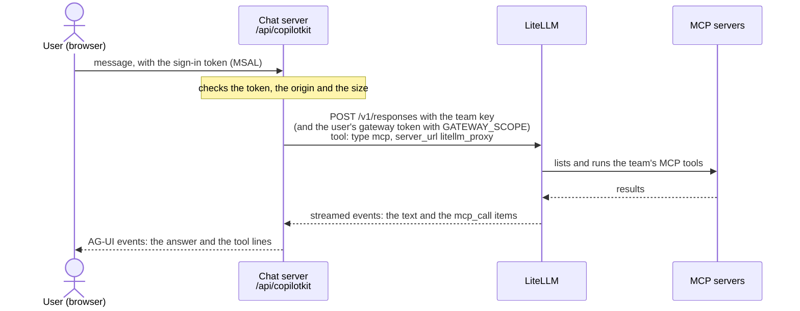
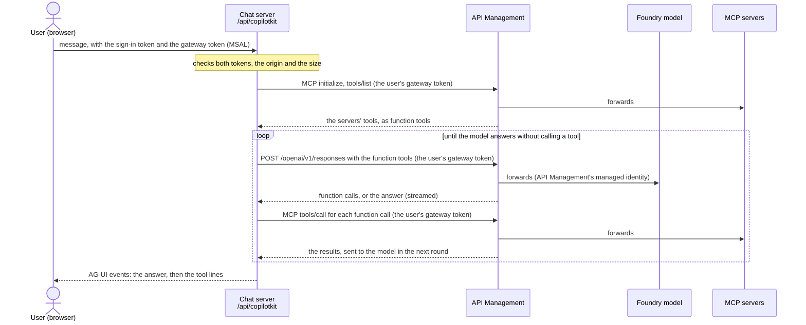

# Chat UI

A small Next.js chat ([CopilotKit](https://docs.copilotkit.ai) on [AG-UI](https://docs.ag-ui.com)) where signed-in
users talk to a model **through a gateway**, and the assistant uses the MCP tools the gateway allows. Every tool call
is shown under the answer with its arguments and its result, or with the error or refusal that stopped it, so that
what the gateway ran (or blocked) is visible.

Three modes, chosen with `CHAT_GATEWAY`: two gateways, and a Foundry hosted agent ([Foundry mode](#foundry-mode)).

**`litellm` (default): LiteLLM runs the tool loop.**



**`apim`: API Management is only a proxy; this server runs the tool loop.**



With LiteLLM, the app never calls an MCP server: LiteLLM decides which tools exist for the team's key and runs them;
the app shows what LiteLLM reports. The team key stays on the server. With API Management, see
[API Management mode](#api-management-mode).

| Path | Role |
|---|---|
| `app/page.tsx`, `app/providers.tsx` | Sign-in (MSAL, popup) and the chat |
| `app/tool-call.tsx` | How a tool call is shown |
| `app/auth/callback/page.tsx` | Returns the sign-in popup's result to the page |
| `app/api/copilotkit/[[...slug]]/route.ts` | The CopilotKit runtime endpoint |
| `app/api/config/route.ts`, `app/api/health/route.ts` | Public settings (sign-in, title, intro); the container probe |
| `app/api/session/route.ts`, `lib/server/session-handler.ts` | Foundry mode: starts the agent's session when a chat opens |
| `lib/server/handler.ts` | Origin check, sign-in, 128 KiB body limit, request ids, runs the agent |
| `lib/server/auth.ts` | Entra token validation: the sign-in token, the gateway token when `GATEWAY_SCOPE` is set, the Foundry token in Foundry mode |
| `lib/server/agent.ts` | The `chat` agent: conversation in, AG-UI events out, errors as chat messages; picks the gateway |
| `lib/server/responses-stream.ts` | One streamed Responses API call (either gateway): refusals, server-sent events, its span |
| `lib/server/litellm.ts` | LiteLLM mode: the team key, the user's token, LiteLLM's MCP tool |
| `lib/server/responses-to-ag-ui.ts` | Responses events → AG-UI events: the text (both modes) and LiteLLM's `mcp_call` items |
| `lib/server/foundry.ts`, `lib/server/foundry-sessions.ts` | Foundry mode: calls the hosted agent with the user's tokens, reusing its session per chat thread; its `function_call` items → AG-UI events |
| `lib/server/tool-loop.ts` | API Management mode: the tool loop (model rounds, tool calls, their AG-UI events) |
| `lib/server/mcp-tools.ts` | API Management mode: the MCP servers through the gateway (connect, list, call, close), function tool names |
| `lib/tool-result.ts` | A tool result as the chat shows it (`ok` or `error`) |
| `instrumentation.ts`, `lib/server/azure-monitor.ts` | Starts OpenTelemetry with Application Insights at server start |
| `lib/server/telemetry.ts` | The chat's spans: one per run, one per model call, one per MCP call in apim mode (see [Telemetry](#telemetry)) |

## Settings

| Variable | Required | Meaning |
|---|---|---|
| `CHAT_GATEWAY` | no, `litellm` | `litellm` (LiteLLM runs the MCP tools), `apim` (Azure API Management; this server runs them) or `foundry` (a Foundry hosted agent runs its tools as the user) |
| `GATEWAY_URL` | yes | HTTPS, no credentials, query or fragment (a trailing `/` is dropped). `litellm`: LiteLLM's base URL (`azd env get-value LITELLM_URL`), requests go to `{GATEWAY_URL}/v1/responses`; `apim`: API Management's OpenAI v1 base, `https://<apim>.azure-api.net/openai/v1`, requests go to `{GATEWAY_URL}/responses`; `foundry`: the Foundry project endpoint (`azd env get-value FOUNDRY_PROJECT_ENDPOINT`), requests go to the agent's Responses endpoint |
| `CHAT_MODEL` | yes | The model alias (LiteLLM) or deployment name (API Management), e.g. `gpt-6-luna` (`azd env get-value FOUNDRY_MODEL_DEPLOYMENT_NAME`) |
| `LITELLM_API_KEY` | `litellm` only | The team's LiteLLM virtual key (on Azure, from the Key Vault secret `CHAT_UI_LITELLM_KEY_SECRET_NAME`); server only. Not read in `apim` mode, so never sent to API Management |
| `UI_TENANT_ID` | yes | Entra tenant (GUID) |
| `UI_CLIENT_ID` | yes | The app registration used both as the SPA and as the API (GUID) |
| `UI_SCOPE` | no, `Chat.Use` | The delegated scope the API exposes; the browser asks for `api://{UI_CLIENT_ID}/{UI_SCOPE}` |
| `UI_ORIGIN` | no, `http://localhost:3000` | The page's origin: HTTPS, or `http://localhost` / `http://127.0.0.1` for development |
| `ALLOWED_USER_OBJECT_IDS` | no | Comma-separated user object ids (GUIDs) allowed to chat. Without it, every user who can sign in to the app registration may chat: limit who can sign in with Entra instead (an app role assignment required on the app, e.g. for a group) |
| `GATEWAY_SCOPE` | `apim` only | The gateway app registration's delegated scope, `api://{gateway app id}/{scope}`: the browser gets the user's own token for it. `litellm`: optional, only when LiteLLM runs the Agent 365 guardrail (see [Agent 365 guardrail](#agent-365-guardrail)); `apim`: required, it is the credential for every call to API Management |
| `FOUNDRY_AGENT` | `foundry` only | The hosted agent's name in the project, e.g. `travel-assistant` |
| `MCP_SERVERS` | `apim` only | The MCP servers API Management exposes: comma-separated `label=url`, e.g. `notes=https://<apim>.azure-api.net/notes/mcp,files=…`. Label `^[a-z][a-z0-9_]{0,30}$`, unique (it prefixes the tool names: `notes-add_note`); URL HTTPS without credentials, query or fragment |
| `CHAT_TITLE` | no, `Chat` | The page's title |
| `CHAT_INTRO` | no, a generic line | The text under the title |
| `CHAT_INSTRUCTIONS` | no, a generic prompt | The model's instructions: say which tools to use for what; server only |
| `APPLICATIONINSIGHTS_CONNECTION_STRING` | no | Turns OpenTelemetry on: traces and metrics to that Application Insights resource |
| `AZURE_CLIENT_ID` | no | The managed identity that sends them (in Azure); without it, your Azure CLI sign-in |

`/api/config` returns only `{tenantId, clientId, scope, origin, title, intro}`, plus `gatewayScope` when `GATEWAY_SCOPE` is set and `foundryScope` in Foundry mode.

**Sign-in rules** (`/api/copilotkit`): a `Bearer` token signed RS256 by the tenant (`https://login.microsoftonline.com/{tenant}/v2.0`),
audience `UI_CLIENT_ID`, with `exp`, `iat`, `oid`, `tid`, `azp` and `scp`; `tid` is the tenant, `azp` is `UI_CLIENT_ID`,
the token is delegated (no `idtyp: app`), `scp` contains `UI_SCOPE`, and `oid` is in `ALLOWED_USER_OBJECT_IDS` when it is set.
Otherwise 401 (no or invalid token) or 403 (wrong caller, scope or user). The app registration needs the SPA redirect
URI `{UI_ORIGIN}/auth/callback` and the exposed scope.

## Agent 365 guardrail

When LiteLLM runs Microsoft's Agent 365 guardrail on MCP tool calls, it needs to know **which user** is calling, not
only which team. A call to LiteLLM then carries two credentials:

| Header to LiteLLM | Credential | Proves |
|---|---|---|
| `x-litellm-api-key` | The team's LiteLLM key (`LITELLM_API_KEY`), from the server | Which team: models and MCP servers it may use |
| `Authorization: Bearer …` | The signed-in user's own Entra token for the gateway's app registration | Which user: the guardrail checks it on every tool call |

With only the team key in `Authorization`, LiteLLM refuses the tool calls ("the caller did not present an Entra
bearer token"). Set `GATEWAY_SCOPE` to turn this on; without it the app sends exactly what it sent before (the team
key in `Authorization`, no gateway token).

With `GATEWAY_SCOPE` set:

1. The browser, signed in as before, also gets a token for `GATEWAY_SCOPE` silently from MSAL (same account), and
   sends it on each chat request in `x-gateway-token`, next to the sign-in token in `Authorization`. The gateway's app
   registration pre-authorizes the chat's app on that scope, so no consent prompt is expected; if Entra still wants
   an interaction, **Renew sign-in** asks for it in the same popup flow.
2. `/api/copilotkit` checks the sign-in token as before, then requires `x-gateway-token`: signed RS256 by the tenant
   (same v2 issuer), audience the gateway app id from `GATEWAY_SCOPE`, `azp` this chat's app, delegated (no
   `idtyp: app`), `scp` containing the scope name, and the same `oid` and `tid` as the sign-in token. Otherwise 401
   (missing, invalid or expired) or 403 (wrong caller, scope or another user).
3. The agent calls LiteLLM with the team key in `x-litellm-api-key` and the gateway token in `Authorization`.

The gateway token is never logged, is not passed to the CopilotKit runtime, and is removed from gateway messages
shown in the chat.

## API Management mode

Azure API Management is a proxy: it has no agent loop and does not run MCP tools for a model. With
`CHAT_GATEWAY=apim`, this server runs the loop (`lib/server/tool-loop.ts`), once per chat message:

1. **Tools.** It connects to each server in `MCP_SERVERS` with the official MCP SDK (`@modelcontextprotocol/sdk`,
   Streamable HTTP) and lists its tools. Each tool becomes a Responses API function tool named `<label>-<tool>`
   (characters outside `[a-zA-Z0-9_-]` become `_`, at most 64 characters, a name already taken gets `_2`, `_3`…),
   with the MCP input schema as its parameters and `strict: false`.
2. **Round 1.** `POST {GATEWAY_URL}/responses` with `{model, stream: true, instructions, input: the conversation,
   tools}`. The answer's text is streamed to the chat as it comes; the `function_call` items (`call_id`, `name`,
   `arguments`) are collected.
3. **Tool calls.** When the response completes with function calls, each is run in turn with MCP `tools/call`: the
   arguments are parsed from JSON (not an object → an error result, the tool is not called); a result with `isError`,
   a tool that throws, or a tool the model made up gives an error result. The text content is joined; shown results
   are truncated to 16 KiB and errors redacted, as in LiteLLM mode. Each call becomes `TOOL_CALL_START`, `_ARGS`,
   `_END` and `_RESULT` (`ok` or `error`), held back until the end.
4. **Next round.** `previous_response_id` is the last response's id and `input` only the
   `{type: "function_call_output", call_id, output}` items (errors start with `Error: `): the model's side keeps the
   conversation, its function calls and its reasoning (stored responses: the Responses API's default `store: true`).
5. **Done** when a response has no function calls: the tool lines of all rounds are sent after the answer, as in
   LiteLLM mode. At most **6 model rounds**: if the sixth still asks for tools, its calls are not run and the chat
   ends with a ⚠️ message and `RUN_ERROR` `gateway:too_many_tool_rounds`. The MCP clients are closed at the end of the
   run, also when it fails or is cancelled.

**Identities.** Every call from this server to API Management, to the model and to each MCP server, carries the
signed-in user's own Entra token for the gateway (`GATEWAY_SCOPE`, checked as in [Agent 365 guardrail](#agent-365-guardrail))
as `Authorization: Bearer`; never a key. API Management validates it, and calls Foundry with its own managed identity;
the MCP servers behind it see whatever API Management forwards. `LITELLM_API_KEY` is not read in this mode.

**Blocked or unreachable servers.** A server that fails to connect or to list its tools is left out for this message,
and its tools are not offered. When Agent 365 blocks a server for the user, API Management answers `initialize` with
HTTP 200 and a JSON-RPC error (`{"code": -32000, "message": "Access to MCP server 'notes' is blocked.", "data":
{"code": "AccessBlockedByGateway", …}}`); a 401/403 or a network error is handled the same way. The chat shows it like
any failed tool call, to keep one way of showing failures: a line `notes (connect)` marked `failed`, whose error is the
reason (redacted), e.g. `MCP error -32000: Access to MCP server 'notes' is blocked.`. The model answers with the tools
that are left. In telemetry it counts as a tool call with an error.

**Failures.** A refusal before the stream (401/403 from API Management's token check, 429, 5xx, a model refusal) is
shown as in LiteLLM mode: `The gateway refused the request (HTTP 401). <reason>` with the gateway's message
(`error.message`, or API Management's own `message`), redacted, and a request id. Stream failures are handled as in
LiteLLM mode. Tool lines already run are shown before the ⚠️ message.

**Limits.** 6 model rounds per message; tools run one after the other, each `tools/call` with a 60 s timeout; each
model call 180 s; up to 10 pages of `tools/list` per server; text content only (images and resources in tool results are
not shown or sent to the model); every message reconnects to the MCP servers.

## Foundry mode

`CHAT_GATEWAY=foundry`: the chat talks to a Foundry hosted agent (`FOUNDRY_AGENT`, Responses protocol), which runs its
own tools as the signed-in user. This server never calls the gateway.

- The browser asks for two more tokens of the same user: for the gateway (`GATEWAY_SCOPE`, required) and for Foundry
  (`https://ai.azure.com/user_impersonation`), sent in `x-gateway-token` and `x-foundry-token`. The chat's app
  registration needs consent for Foundry's API (the infrastructure grants it tenant-wide).
- The server checks both like the sign-in token: delegated, asked by this chat, for the signed-in user. Foundry's API
  issues v1 tokens (issuer `https://sts.windows.net/{tenant}/`, audience `https://ai.azure.com`, client in `appid`).
- It calls `{GATEWAY_URL}/agents/{FOUNDRY_AGENT}/endpoint/protocols/openai/responses?api-version=v1` with the Foundry
  token, and forwards both tokens in `x-client-foundry-token` and `x-client-gateway-token`, which Foundry passes on to
  the agent's container.
- The agent reports each tool call as a `function_call` item, then its `function_call_output`: each is shown as soon
  as it arrives (unlike the gateway modes, where tool lines follow the answer), since another agent over A2A can take
  several seconds.
- The agent's session is started as soon as a chat opens: the page sends the chat's thread id to `/api/session`
  (same checks as the chat), which starts a session as the user (`POST …/agents/{agent}/endpoint/sessions`), so the
  agent's container is running by the first message (a new session takes about 5–8 s to start). Every message of the
  thread then reuses it (`agent_session_id` in the request body); a message sent while it starts waits for it. The
  server remembers one session per user and thread, in memory, for up to 15 minutes of inactivity
  (`lib/server/foundry-sessions.ts`).

## Run locally

Node 22 or later.

```bash
cd services/chat-ui
npm ci
cp .env.example .env.local    # git-ignored: fill in the values, never commit the key
npm run dev                   # http://localhost:3000
```

To fill `LITELLM_API_KEY` (LiteLLM mode) without printing it, from the repository root:

```bash
echo "LITELLM_API_KEY=$(az keyvault secret show --vault-name "$(azd env get-value KEY_VAULT_NAME)" \
  -n "$(azd env get-value CHAT_UI_LITELLM_KEY_SECRET_NAME)" --query value -o tsv)" >> services/chat-ui/.env.local
```

Checks: `npm run typecheck && npm run lint && npm test && npm run build`. The tests use the LiteLLM event sequences observed
live (`tests/helpers.ts`) and, for API Management mode, Responses API function-call events in the documented shape
with a stand-in for the MCP servers (`tests/apim-helpers.ts`) and the real MCP SDK client against in-process MCP
servers (`tests/mcp-tools.test.ts`); they need no network.

The container (`Dockerfile`) runs the standalone server as the non-root `node` user on port 3000;
`GET /api/health` answers `{"status":"ok"}` without sign-in. Next.js and CopilotKit usage telemetry (sent to their
vendors) are disabled.

## Telemetry

With `APPLICATIONINSIGHTS_CONNECTION_STRING` set, `instrumentation.ts` starts Microsoft's Azure Monitor
OpenTelemetry distro when the server starts. Application Insights accepts only Entra-authenticated ingestion, so
the sender (the app's managed identity, or you locally) needs the **Monitoring Metrics Publisher** role on it.
The app's role name is `chat-ui` (`OTEL_SERVICE_NAME` overrides it).

| Span | Kind | Attributes |
|---|---|---|
| Incoming requests, from Next.js (with its route-loading spans under them) | server | method, route, status; the container's health probe too, every 10 seconds |
| `chat run`, one per message | internal | `enduser.id` (the user's object id, shown as the authenticated user), `chat.request_id` (the id in error messages and logs), `gen_ai.request.model`, `chat.outcome` (`completed`, `cancelled` or `failed`), `chat.tool_calls`, `chat.tool_errors`, `chat.tool_names`, and on failure `chat.error.stage` and `chat.error.code` |
| `POST /v1/responses` (LiteLLM) or `POST /openai/v1/responses` (API Management), one per model call, until its stream ends | client | `url.full`, `server.address`, `gen_ai.request.model`, `http.response.status_code`, and on failure `error.type` |

| `MCP tools/call <tool>`, one per MCP tool call in API Management mode | client | `chat.mcp.server` (the label), `gen_ai.tool.name` (the MCP tool's name), error status when the tool fails or reports an error |

The gateway call sends its trace context in `traceparent`, so that LiteLLM's own spans (the model, the MCP tools, the
Agent 365 guardrail) can join the same trace when LiteLLM exports to the same Application Insights resource. In API
Management mode each MCP `tools/call` request carries its span's `traceparent` too (the MCP client's `fetch` adds the
active trace context to every request; `initialize` and `tools/list` carry the run's). The run's tool counts come from
the tool lines the chat shows, so they work the same in both modes.
Spans never hold what was said: no prompts, answers, instructions, tool arguments or results, keys or tokens
(`tests/telemetry.test.ts` checks it). Next.js's span for each `fetch` is turned off, since the gateway call has its own.
Logs stay on the console (one JSON line per error with the request id), collected by the platform.

## What LiteLLM v1.106.6 streams

Request (checked live with the team key):

```json
POST {GATEWAY_URL}/v1/responses
Authorization: Bearer <team key>
{ "model": "gpt-6-luna", "stream": true, "instructions": "...", "input": [{"role": "user", "content": "..."}],
  "tools": [{"type": "mcp", "server_label": "litellm", "server_url": "litellm_proxy", "require_approval": "never"}] }
```

The answer is `text/event-stream`: one JSON event per `data:` line, ending with `data: [DONE]`. Observed with a
notes MCP server, for "add a note, then list notes":

| Event | Meaning | In the chat |
|---|---|---|
| `response.created`, `response.in_progress` | Started | — |
| `response.output_item.added` (item `function_call`, name `notes-add_note`), `response.function_call_arguments.delta` / `.done`, `response.output_item.done` | The model asks for a tool | — (shown once, from the `mcp_call` below) |
| `response.mcp_list_tools.in_progress` / `.completed`, `response.output_item.done` (item `mcp_list_tools`, `server_label: litellm`, tool names prefixed with the server: `notes-add_note`, `notes-list_notes`) | LiteLLM lists the team's MCP tools (first round only) | — |
| `response.output_item.added` (item `mcp_call`: `id: mcp_…`, `name`, `arguments`, `status: in_progress`) | LiteLLM runs the tool | `TOOL_CALL_START` (name), `TOOL_CALL_ARGS`, `TOOL_CALL_END` |
| `response.mcp_call.in_progress`, `response.mcp_call_arguments.delta` / `.done`, `response.mcp_call.completed` | Progress of that call (LiteLLM sends these, and the `added` item above, together after the call ran) | — |
| `response.output_item.done` (item `mcp_call`, `status: completed`, `output`, `error` absent or `null`) | The tool's result | `TOOL_CALL_RESULT` |
| `response.output_item.added` / `.done` (item `reasoning`, encrypted) | Model reasoning | — |
| `response.output_item.added` (item `message`, `phase: commentary` or `final_answer`), `response.content_part.added`, `response.output_text.delta`, `response.output_text.done`, `response.content_part.done`, `response.output_item.done` | Assistant text; a response can hold several messages | `TEXT_MESSAGE_START`, `_CONTENT`, `_END` |
| `response.completed` (`response.status: completed`) | Finished | `RUN_FINISHED` |

**Failures:**

- **A tool that fails is still `status: completed`, with `error: null`.** The error is only in `output`: the notes
  server's own error gave `"Error executing tool list_notes"` (checked live with `limit: 500`; with the MCP Python SDK
  2.3, a server's own message follows only when the tool raises `ToolError`: `"Error executing tool list_notes: …"`); in LiteLLM's source
  (`litellm/responses/mcp/litellm_proxy_mcp_handler.py` at v1.106.6) a guardrail block gives `"Tool call blocked: …"`,
  a gateway `HTTPException` gives `"Tool call failed: …"`, and other exceptions `"Error executing tool: …"`. The app
  treats these prefixes (or a non-empty `error`, or `status: failed`) as an error result.
- **A refusal before the stream** is a JSON error with the HTTP status (checked live): an unknown key gives 401
  `token_not_found_in_db` (its message echoes a masked key and the key's hash: the app removes both), a model the
  team may not use gives 403 `team_model_access_denied`.
- **A failure during the stream** is an `error` event (`error: {type: "mcp_gateway_error", code, message}` in the
  source), or `response.failed` / `response.incomplete`; a stream that ends without `response.completed` is also a failure.

**Seen live:** the model often repeated a call (`add_note` three times for one request) and then answered that the
list tool "isn't available", although LiteLLM had run `list_notes` and returned notes. LiteLLM's follow-up round does
not seem to give the model the tool results the way it expects; worth an experiment before reading too much into the
model's text. The chat shows each call LiteLLM actually ran, so the repetition is visible.

## How tool calls appear

Each `mcp_call` LiteLLM ran is one folded line under the answer (`app/tool-call.tsx`, registered for every tool name
with CopilotKit's `renderToolCalls`; the agent sends the answer first): the tool name as the gateway names it
(`<server>-<tool>`) and its status; unfolded, the arguments and the result. A failed call is marked `failed`, in red,
and open. A tool error does not end the run: the model usually explains it.

In API Management mode the lines are the calls this server ran, named the same way, plus a `<label> (connect)` line for
each MCP server that could not be used (see [API Management mode](#api-management-mode)).

A refusal or failure of the whole request (401/403 from the gateway, a stream error, a bad request) appears as an
assistant message starting with ⚠️, with the gateway's reason and a request id, and ends the run with `RUN_ERROR`. The
server logs only the request id, stage and code. Tool calls and their results stay in the chat; only the user's and
assistant's text is sent back to the gateway on the next turn.
